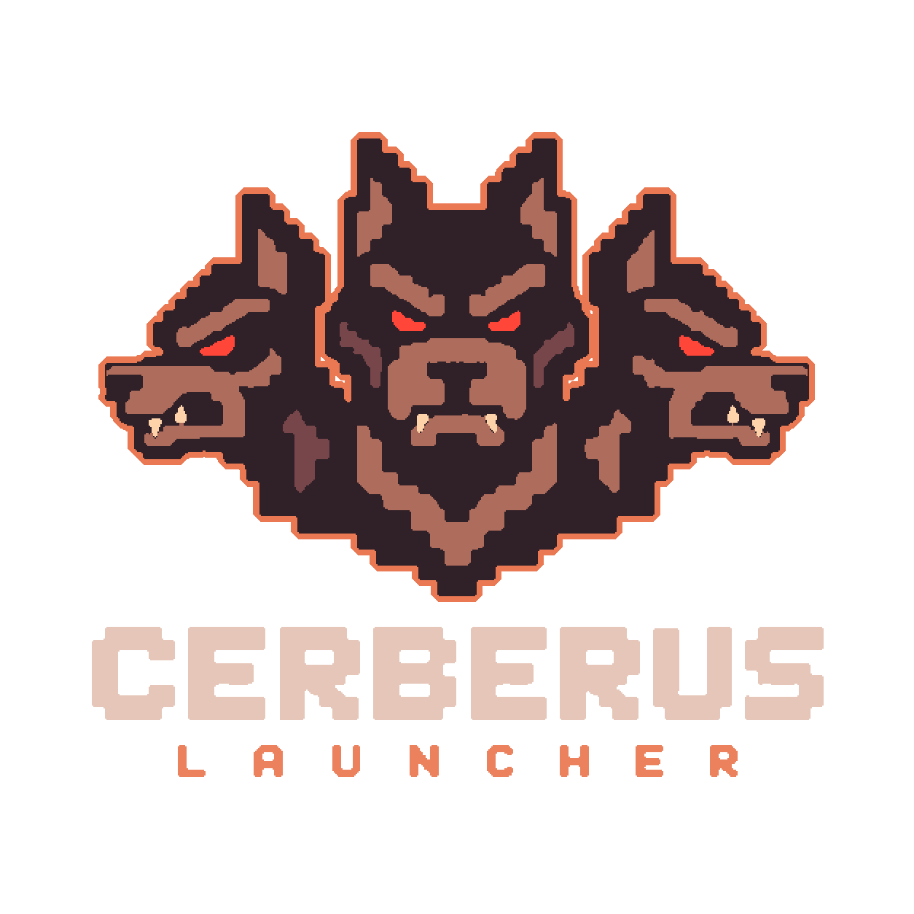
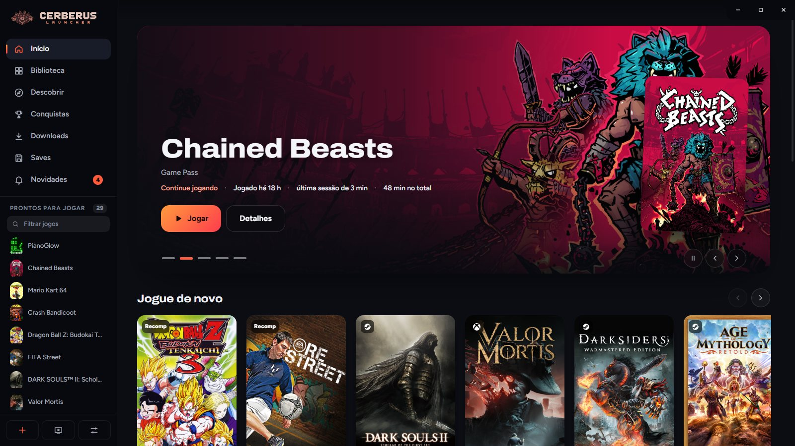
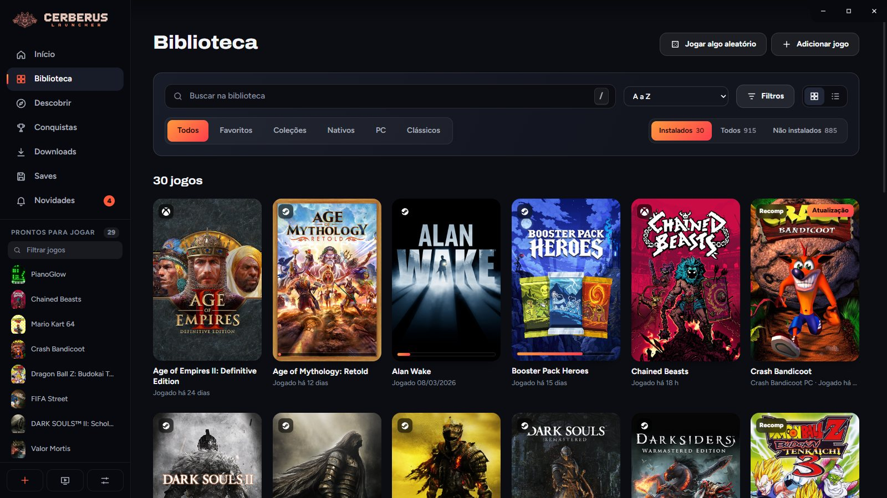
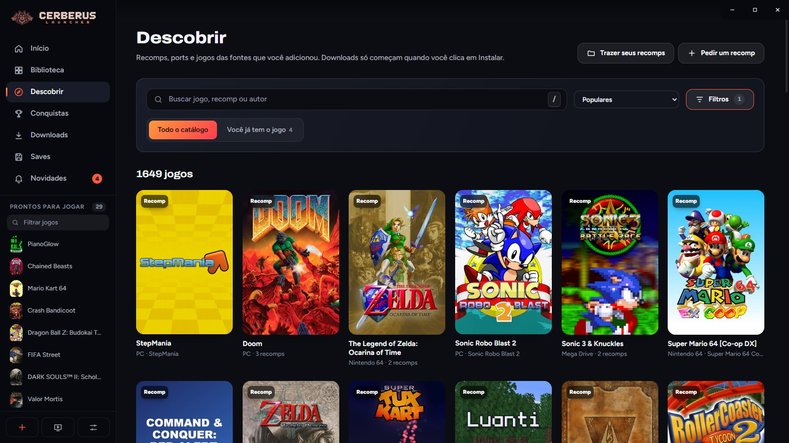
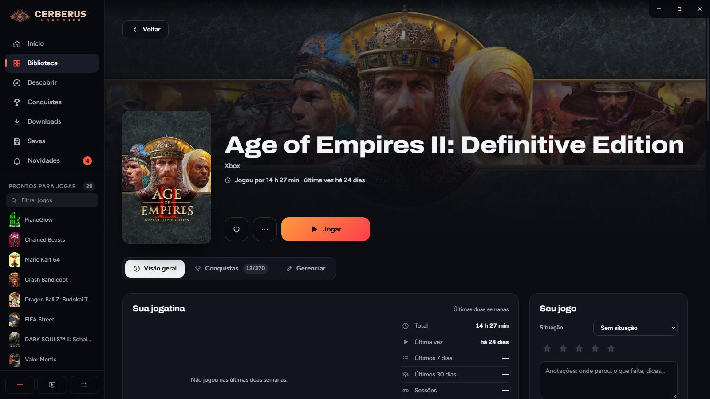
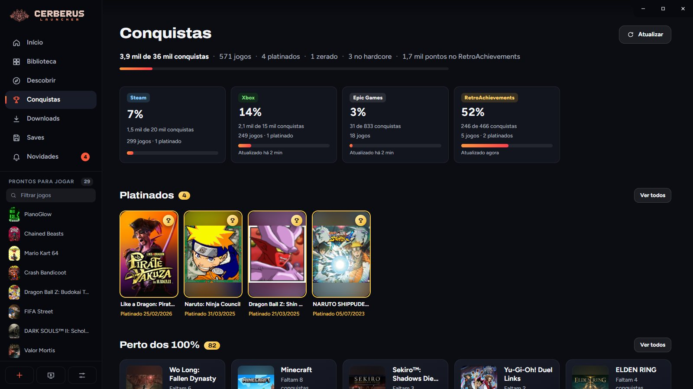
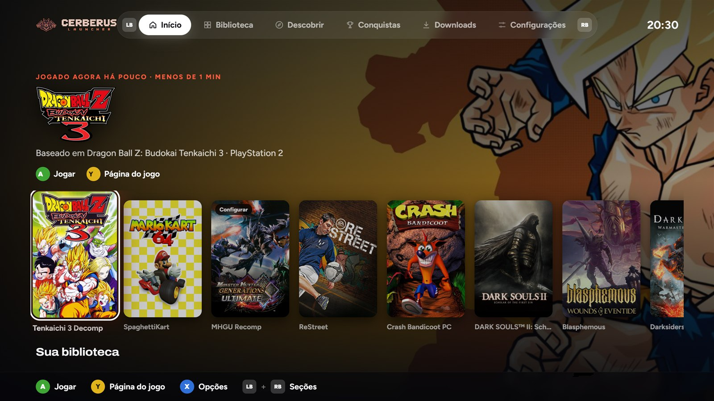
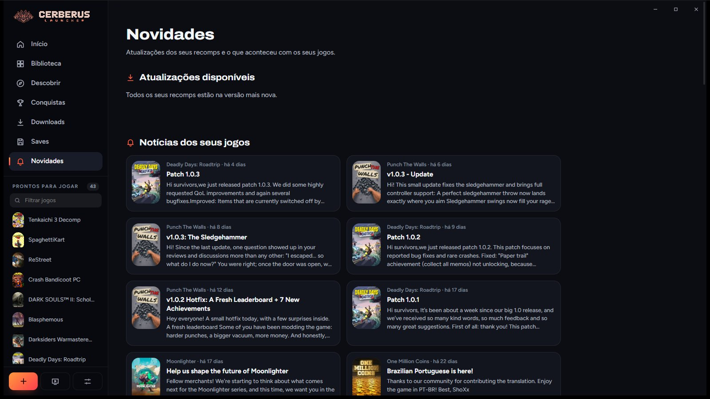
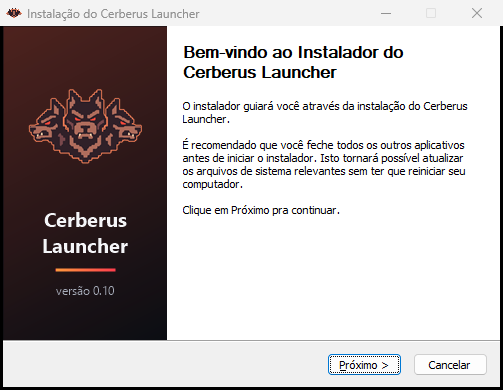
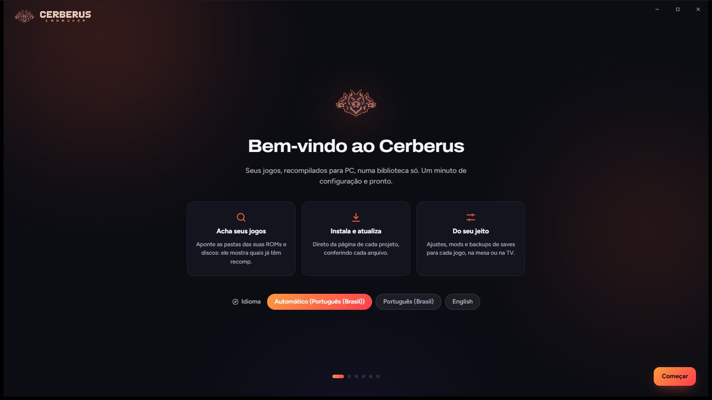

<div align="center">



# Cerberus Launcher

**One library for your PC games, native PC recomps of console classics, and your own ROMs.**

[](https://github.com/rogeriojunior31/CerberusLauncher/releases/latest)
[](LICENSE)


**English** · [Português (Brasil)](README.pt-BR.md)

[Download](https://github.com/rogeriojunior31/CerberusLauncher/releases/latest) · [Documentation](docs/README.md) · [Changelog](CHANGELOG.md) · [Contributing](CONTRIBUTING.md)



</div>

---

## What is Cerberus?

Cerberus is a free, open-source game launcher for Windows, written entirely in Rust. It does three jobs:

- **It brings your PC games together.** Games from Steam, Epic and the Xbox app show up on their own, and so do the games on your Epic and Microsoft accounts that aren't installed yet (and PC Game Pass, if you subscribe). Any `.exe` can be added by hand.
- **It installs and updates recomps.** A *recomp* is a native PC version of a console game that the community rebuilt from the original code (Zelda 64: Recompiled, Ship of Harkinian, Unleashed Recompiled and many more). Cerberus downloads each one straight from its developers' official releases and hands it **your own copy** of the game.
- **It plays your classics.** ROMs from your folders open in RetroArch, which Cerberus installs and sets up for you, with RetroAchievements.
- **It follows your achievements.** Steam, Xbox, Epic and RetroAchievements on one page, with awards, rarity and a notice the moment one unlocks.

> [!IMPORTANT]
> Every recomp and every classic needs a copy of the game that you own. Hydra sources you add may offer HTTP(S) downloads, fetched only when you ask. Use only sources you trust.

> [!NOTE]
> Cerberus speaks **English** and **Brazilian Portuguese**. It follows your Windows language, and you can pick one in **Settings → Appearance → Language**. More languages are on the way.

## Features

| | |
|---|---|
|  | **Library**<br>Steam, Epic, the Xbox app and your own games in one place, opening on what's installed. The same game in two stores is one card with both logos, and its page lets you choose which store installs or plays it. Installing or uninstalling through a store shows up within seconds. You get favorites, collections, hidden games, custom art from SteamGridDB, and play time and history for every game. Every game you can start right now is also in the side menu, under **Ready to play**. |
|  | **Discover**<br>Over 2,000 recomps and native ports. You can search by game, console or author, and filter by genre or by what a recomp adds (controller, achievements, multiplayer, widescreen, mods). Installs come from the developers' GitHub, GitLab or Forgejo releases, with checksum verification. You can pause and resume downloads. Games from sources you added show apart, in **Games from your lists**, searched by the app a page at a time. |
|  | **Game page**<br>Play time, versions, saves, game settings, mods, screenshots and management, all in one page. Store games list the DLCs you have and can be uninstalled or checked through their store, from **Manage** or the **…** menu, with a second click to confirm. **Easy Setup** finds your copy in your ROM folders and delivers it the way each recomp expects. That works for a ROM, an extracted folder, an ISO, an Xbox or Xbox 360 image, a CHD or a CSO. |
|  | **Achievements**<br>Steam, Xbox, Epic and RetroAchievements on one page: your platinums (games at 100%), the games closest to it, the easiest ones still missing, your rarest ones, the latest unlocks and each game's full list with rarity. Each account says when it last updated, and **Update** asks again. A notice shows over the game the moment one unlocks. |
|  | **Big Picture Mode**<br>A TV interface for the couch. You can use a controller, keyboard or mouse, and it opens full screen on the monitor you choose. It has its own Library filters (including the games not installed, which **A** installs through their store), store logos on the covers, genres in Discover, an Achievements tab and TV-sized notices. |
|  | **News**<br>Updates waiting for your recomps, the latest announcements from the developers of your Steam games, and what happened lately with every game. |

### And also

- **Achievements hub:** every game with achievements from Steam, Xbox, Epic and RetroAchievements, the latest unlocks, your platinums (games at 100%), the games closest to it, and each game's full list with rarity and secret achievements. RetroAchievements awards (beaten, completed, mastered) show as badges, hardcore ones in gold. A game that reached 100% stays a platinum when a DLC adds achievements ("Platinum before the DLC"), and achievements a store took back are kept apart under **Revoked**. Steam works straight from this PC; with your free Steam Web API key it covers your whole account. While you play a Steam game, Cerberus tells you when an achievement unlocks; for Xbox and Epic games, right after you close them.
- **Your accounts:** sign in to Epic and Microsoft (Xbox) in **Settings → Accounts** to see the games you own and their achievements. Only a token that was taken back asks you to sign in again; a store asking for a pause or being down is just a wait. **PC Game Pass** games show up only if you turn them on (they're for subscribers), from your Windows region's catalog.
- **Make it yours:** Dark or Black (OLED) theme, five accent colors, window size from 90% to 125%, and a search box in **Settings** that takes you straight to any option.
- **Your data in one file:** **Settings → Storage → Copy my data** saves the library, favorites, collections, notes, play time, achievements, chosen covers and settings in a `.zip` (never your keys or passwords). **Restore from a copy** brings it back, on this PC or another one.
- **Save backups:** after every session, before updates and before uninstalling. Cerberus keeps the 10 most recent backups, and can copy them to the cloud through any synced folder (OneDrive, Google Drive, Dropbox).
- **Mods:** one-click mods from Thunderstore and GameBanana, including Ship of Harkinian, Starship, SpaghettiKart, Ghostship, Unleashed and Marathon Recompiled.
- **In-game tools:** <kbd>F12</kbd> takes a screenshot of just the game window. <kbd>Ctrl</kbd>+<kbd>F12</kbd> (or **View + Menu** on a controller) opens a menu on top of the game, with play time, screenshots, "back to Cerberus" and "close game". **Settings → While playing** turns each one on or off, picks the corner for achievement notices, and can minimize Cerberus while a game runs.
- **Visual filters:** Sharp, Vivid, CRT and Film, applied with ReShade.
- **Crash explanations:** when a game closes with an error, Cerberus tells you the cause and where the game's log is. The cause can be a missing DLL, an old Visual C++ runtime or a crash.
- **DLSS:** Cerberus shows which DLSS version a game uses. You can swap it for a DLL you already have and go back to the original at any time.
- **Steam integration:** add any game to Steam (for Steam Deck and Big Picture), or create a desktop shortcut that opens the game through Cerberus.
- **Standalone emulators:** DuckStation, PCSX2, RPCS3, PPSSPP, Dolphin and Cemu, installed from their official releases or found on your PC, with a choice of who opens each console, and the games your emulators already know join your classics.
- **Multi-disc classics:** games on several discs show up as one game, and you swap discs from RetroArch's menu.
- **Windows integration:** tray icon, start with Windows, notifications you choose one by one, and only one copy of Cerberus running at a time.
- **Controllers:** **Settings → Controllers** lists the connected controllers (Xbox, PlayStation, Nintendo) and lets you test every button.
- **Languages:** English and Brazilian Portuguese, following Windows or picked in the settings. The installer speaks both too.

## Download and install

1. Download **`Cerberus-Launcher_<version>_x64-setup.exe`** from the [latest release](https://github.com/rogeriojunior31/CerberusLauncher/releases/latest).
2. Run it. It installs for your user only, so it doesn't ask for administrator rights.
3. On the last page, keep **Run Cerberus Launcher** checked. The setup guide opens.



> [!WARNING]
> The installer isn't code-signed yet, so Windows SmartScreen may say *"Windows protected your PC"*. Click **More info** and then **Run anyway**.

**Requirements:**
- Windows 10 or 11, 64-bit.
- Microsoft WebView2. The installer adds it if your PC doesn't have it.
- For classics: Cerberus installs RetroArch, and some systems need BIOS files from your own console.

## Getting started

The first time Cerberus opens, a short setup guide asks a few questions. You can change every answer later in **Settings**.



1. **Language:** automatic (follows Windows), Português (Brasil) or English.
2. **How you play:** at a desk, or on a TV. If you pick TV, Cerberus starts straight in Big Picture Mode.
3. **Your ROM folders:** Cerberus scans them and shows which of your games already have a recomp.
4. **Where recomps are installed,** with the free space on each drive.
5. **Saves in the cloud:** a folder that OneDrive, Google Drive or Dropbox keeps in sync.
6. **All set:** your games that have a recomp, and what else Cerberus found on this PC: Steam and Epic games, and RetroArch.

### Install a recomp

1. Open **Discover** and search for a game, for example *Mario Kart 64*.
2. Click **Install**. Cerberus downloads the developers' release and checks the file.
3. On the game page, **Easy Setup** shows the copy it found in your ROM folders. If it didn't find one, pick the file yourself.
4. Click **Play**. From now on, play time, save backups and history are tracked.

### Add any other game

Click **+** (Add game) at the bottom of the side menu and pick the game's `.exe`. Cerberus finds its name and cover, and you can edit both.

Some games open a launcher before the game itself. For those, choose which program counts as playing under **Manage → Tracked process**.

### Shortcuts

| While playing | Keyboard | Controller |
|---|---|---|
| Screenshot of the game window | <kbd>F12</kbd> | **View + RB** |
| Open or close the in-game menu | <kbd>Ctrl</kbd>+<kbd>F12</kbd> | **View + Menu**, or hold **View** |
| Move, select and go back in that menu | Arrow keys, <kbd>Enter</kbd>, <kbd>Esc</kbd> | D-pad, **A**, **B** |

| In Big Picture Mode | Keyboard | Controller |
|---|---|---|
| Switch sections | <kbd>Page Up</kbd> / <kbd>Page Down</kbd> | **LB** / **RB** |
| Play, game page, options | <kbd>Enter</kbd>, <kbd>Y</kbd>, <kbd>X</kbd> | **A**, **Y**, **X** |
| Back | <kbd>Esc</kbd> | **B** |
| Leave Big Picture Mode | <kbd>F11</kbd> | Hold **Menu** |

## Where your data lives

| What | Where |
|---|---|
| The program | `%LOCALAPPDATA%\Cerberus Launcher` |
| Library, settings, history, screenshots, save backups, and the recomps installed by default | `%APPDATA%\app.cerberus.launcher` |

Uninstalling from Windows (**Settings → Apps**) removes the program and its shortcuts. **Your data stays**, unless you tick the box to also delete the library, save backups and downloaded recomps.

## FAQ

<details>
<summary><b>Is this legal? Where do the games come from?</b></summary>

Cerberus doesn't host games. Recomps are open-source projects published by their developers on GitHub, GitLab or Forgejo, and each one needs data from **a copy of the game you own**. Direct downloads from Hydra sources you add are optional and only happen when you click Install.
</details>

<details>
<summary><b>The in-game menu or the screenshot doesn't work in a game.</b></summary>

Both need the game to run in a window or in borderless full screen. In exclusive full screen nothing can be shown over the game, and screenshots come out black: Cerberus warns you instead of saving them. Both features also need the game to be started by Cerberus.
</details>

<details>
<summary><b>Is swapping DLSS safe?</b></summary>

Cerberus keeps the game's own DLL and can put it back at any time. A game update or a Steam file check can also bring it back. Don't swap DLSS in online games that use anti-cheat.
</details>

<details>
<summary><b>Some of my Steam achievements are missing.</b></summary>

Without a key, Cerberus reads only what Steam has synced on this PC. Connect your free Steam Web API key in **Settings → Accounts → Steam**, and set **Game details** to **Public** in Steam's privacy settings. See [Achievements](docs/guide/achievements.md).
</details>

<details>
<summary><b>Can I use the RetroArch I already have?</b></summary>

Yes: in **Settings → Emulation**, point Cerberus to your `retroarch.exe`.
</details>

<details>
<summary><b>A recomp I like isn't in the catalog.</b></summary>

Use **Request a recomp** in Discover, or [open an issue](https://github.com/rogeriojunior31/CerberusLauncher/issues/new/choose). The catalog updates without a new version of Cerberus.
</details>

## Documentation

The full documentation lives in **[docs/](docs/README.md)**:

- **Getting started:** [Installation](docs/getting-started/installation.md) · [First launch](docs/getting-started/first-launch.md)
- **User guide:** [Home and News](docs/guide/home-and-news.md) · [Library](docs/guide/library.md) · [Recomps](docs/guide/recomps.md) · [Easy Setup](docs/guide/easy-setup.md) · [Classics](docs/guide/classics.md) · [Achievements](docs/guide/achievements.md) · [Saves](docs/guide/saves.md) · [Mods](docs/guide/mods.md) · [While you play](docs/guide/in-game.md) · [Big Picture Mode](docs/guide/big-picture.md) · [Managing a game](docs/guide/managing-games.md) · [Settings](docs/guide/settings.md)
- **Help:** [Troubleshooting](docs/help/troubleshooting.md) · [FAQ](docs/help/faq.md) · [Data and privacy](docs/help/data-and-privacy.md)
- **Development:** [Architecture](docs/development/architecture.md) · [Building](docs/development/building.md) · [Recomp catalog](docs/development/catalog.md) · [Catalog sources](docs/development/catalog-sources.md) · [Translations](docs/development/translations.md) · [Releasing](docs/development/releasing.md)

## Building from source

You need Rust 1.100 or newer, the `wasm32-unknown-unknown` target, [Trunk](https://trunkrs.dev) and the [Tauri CLI](https://tauri.app):

```sh
rustup target add wasm32-unknown-unknown
cargo install trunk --locked
cargo install tauri-cli --version "^2" --locked

cargo tauri dev      # run with live reload
cargo tauri build    # Windows installer in target/release/bundle/nsis
cargo test --workspace
```

See **[Building](docs/development/building.md)** for details, and **[Architecture](docs/development/architecture.md)** for how the code is organized.

## Contributing

Bug reports, recomp requests and pull requests are welcome. Start with [CONTRIBUTING.md](CONTRIBUTING.md); the [changelog](CHANGELOG.md) lists what each version changed.

## Credits

- Some behavior ideas come from [RecompLauncher](https://github.com/elripalda/RecompLauncher) and [Hydra](https://github.com/hydralauncher/hydra). Cerberus reimplements them from scratch.
- The recomp catalog combines Cerberus's own list with the public list from [recomplauncher.com](https://recomplauncher.com). You can turn that list off in the settings.
- Classic covers come from [libretro-thumbnails](https://github.com/libretro-thumbnails). Community art comes from [SteamGridDB](https://www.steamgriddb.com), using your own free API key.
- Console artwork and emulator icons in Settings › Emulation come from [Hydra](https://github.com/hydralauncher/hydra) (MIT); see `ui/emulation/LICENSE.md`.
- Fonts: [Figtree](https://github.com/erikdkennedy/figtree) and [Archivo](https://github.com/Omnibus-Type/Archivo), under the SIL Open Font License 1.1.
- Every recomp belongs to its developers. Please support their projects.

## License

[MIT](LICENSE) © Cerberus Launcher contributors
