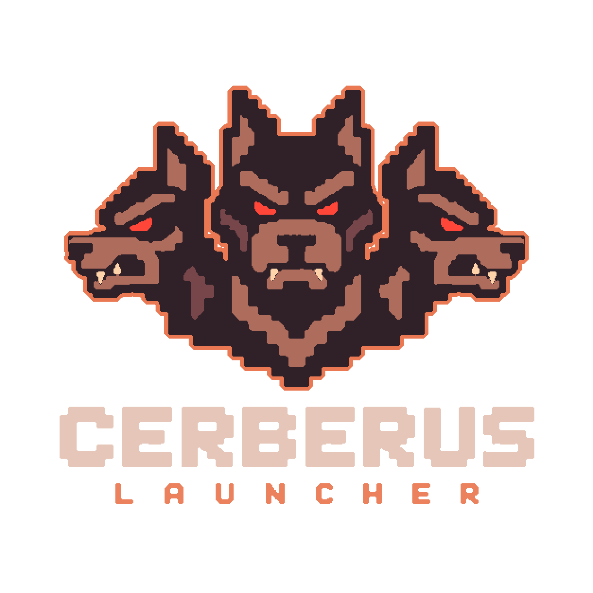
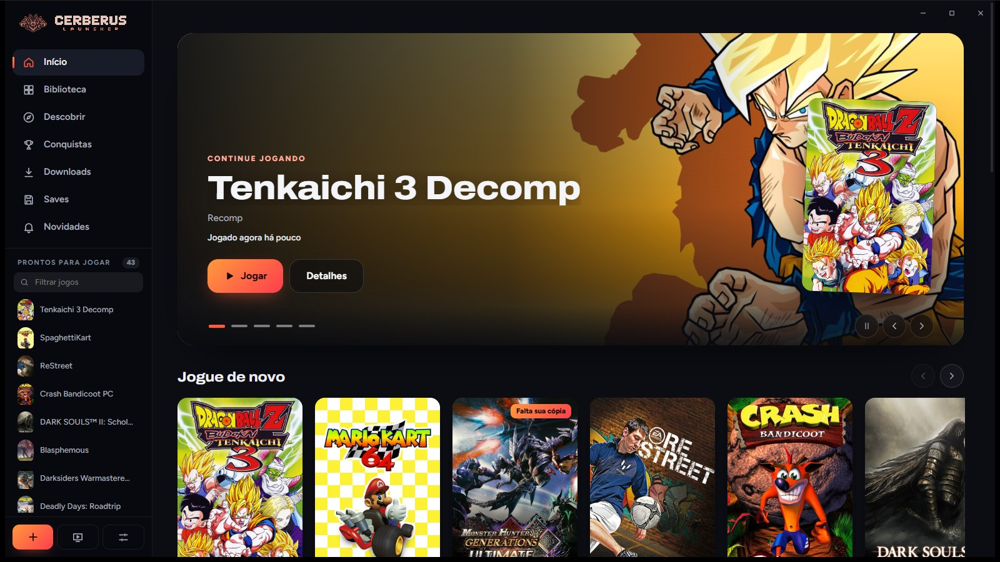
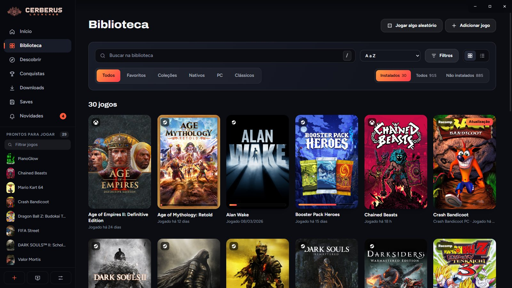
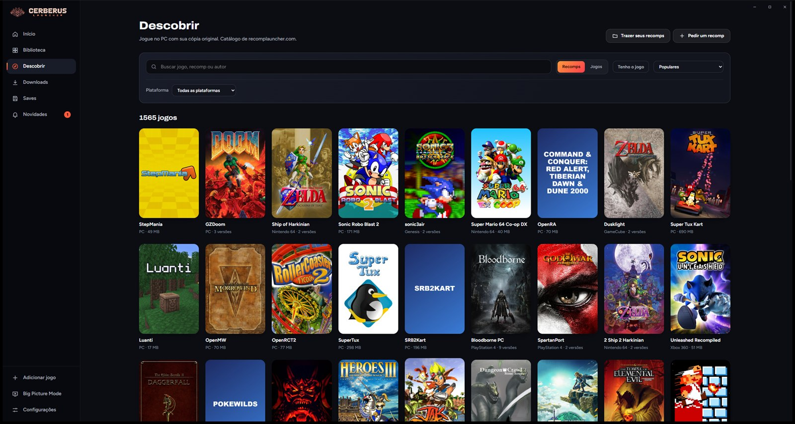
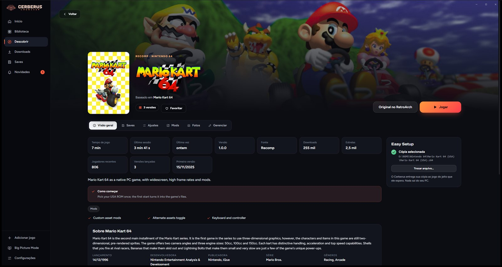
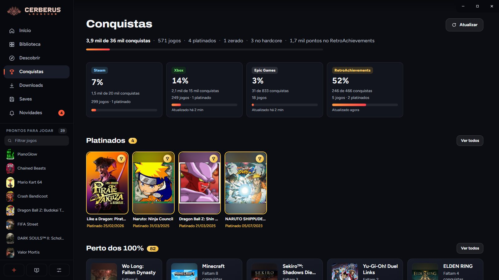
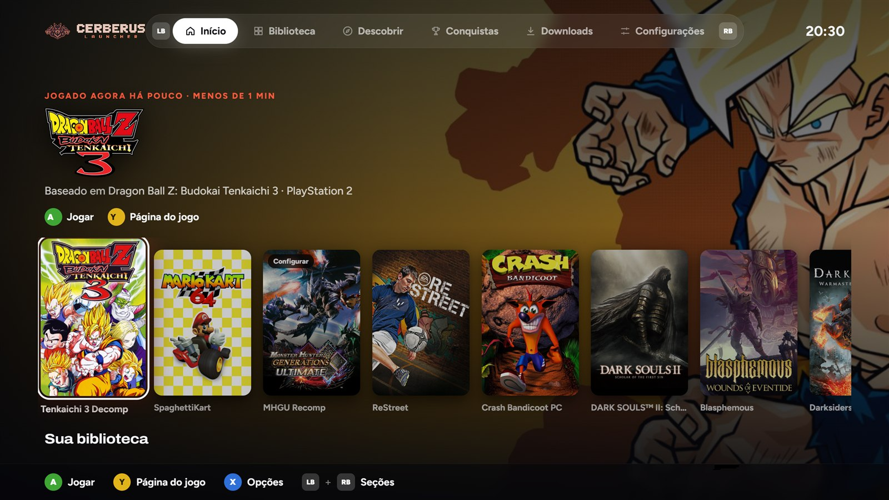
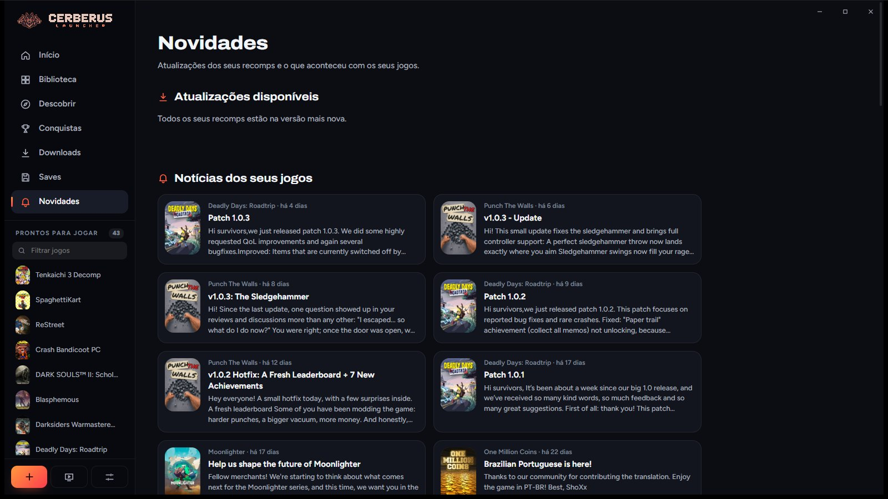
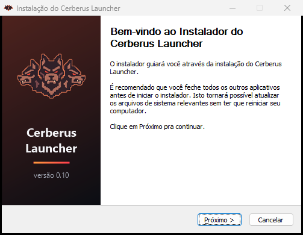
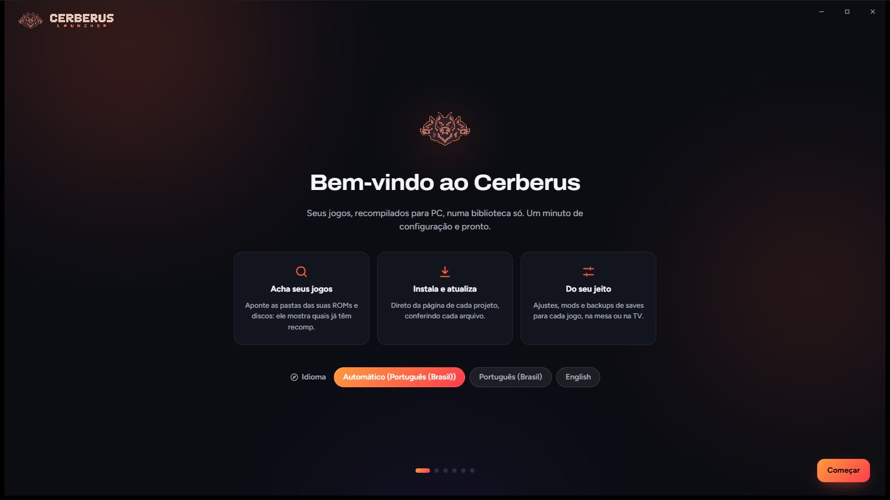

<div align="center">



# Cerberus Launcher

**Uma biblioteca só para os seus jogos de PC, os recomps de clássicos de console e as suas ROMs.**

[](https://github.com/rogeriojunior31/CerberusLauncher/releases/latest)
[](https://github.com/rogeriojunior31/CerberusLauncher/releases)
[](https://github.com/rogeriojunior31/CerberusLauncher/releases/latest)
[](LICENSE)


[English](README.md) · **Português (Brasil)**

[Baixar](https://github.com/rogeriojunior31/CerberusLauncher/releases/latest) · [Documentação](docs/README.md) · [Novidades](CHANGELOG.md) · [Contribuindo](CONTRIBUTING.pt-BR.md)



</div>

---

## O que é o Cerberus?

O Cerberus é um launcher de jogos para Windows, gratuito, de código aberto e feito 100% em Rust. Ele faz três coisas:

- **Junta os seus jogos de PC.** Os jogos da Steam, da Epic e do app Xbox aparecem sozinhos, e também os jogos das suas contas Epic e Microsoft que ainda não estão instalados (e o PC Game Pass, se você assina). Você pode adicionar qualquer `.exe`.
- **Instala e atualiza recomps.** *Recomp* é a versão nativa para PC de um jogo de console, refeita pela comunidade a partir do código original. Alguns exemplos são Zelda 64: Recompiled, Ship of Harkinian e Unleashed Recompiled. O Cerberus baixa cada um direto das releases oficiais dos desenvolvedores e entrega **a sua cópia** do jogo para ele.
- **Roda os seus clássicos.** As ROMs das suas pastas abrem no RetroArch, que o Cerberus instala e configura, com RetroAchievements.
- **Acompanha as suas conquistas.** Steam, Xbox, Epic e RetroAchievements numa página só, com selos, raridade e aviso na hora em que uma conquista cai.

> [!IMPORTANT]
> Cada recomp e cada clássico precisa de uma cópia do jogo que você tem. Fontes Hydra que você adicionar podem oferecer downloads HTTP(S), feitos somente quando você pedir. Use apenas fontes em que confia.

## Recursos

| | |
|---|---|
|  | **Biblioteca**<br>Steam, Epic, app Xbox e seus jogos num lugar só, abrindo no que está instalado. O mesmo jogo em duas lojas é um card só, com os dois logos, e a página dele deixa escolher por qual loja instalar ou jogar. Instalar ou desinstalar pela loja aparece em segundos. Tem favoritos, coleções, jogos ocultos, arte do SteamGridDB, e tempo de jogo e histórico de cada jogo. Os jogos que dá para abrir agora também ficam no menu lateral, em **Prontos para jogar**. |
|  | **Descobrir**<br>Mais de 2.000 recomps e ports nativos, com busca por jogo, console ou autor, e filtro por gênero ou pelo que o recomp traz (controle, conquistas, multijogador, tela larga, mods). Instala das releases dos desenvolvedores no GitHub, GitLab ou Forgejo, conferindo o arquivo. Dá para pausar e continuar downloads. Os jogos das fontes que você adicionou ficam à parte, em **Jogos das suas listas**, buscados pelo app uma página por vez. |
|  | **Página do jogo**<br>Tempo de jogo, versões, saves, ajustes, mods, fotos e gerenciamento numa página só. Jogos de loja mostram as DLCs que você tem e podem ser desinstalados ou verificados pela própria loja, no **Gerenciar** ou no menu **…**, com um segundo clique para confirmar. O **Easy Setup** acha a sua cópia nas pastas de ROMs e entrega do jeito que cada recomp espera: ROM, pasta extraída, ISO, imagem de Xbox ou Xbox 360, CHD ou CSO. |
|  | **Conquistas**<br>Steam, Xbox, Epic e RetroAchievements numa página só: seus platinados (jogos com 100%), os mais perto disso, as mais fáceis que ainda faltam, as suas mais raras, as últimas desbloqueadas e a lista completa de cada jogo, com raridade. Cada conta diz quando atualizou, e **Atualizar** consulta de novo. Um aviso aparece por cima do jogo na hora em que uma conquista cai. |
|  | **Big Picture Mode**<br>Tela para jogar do sofá, com controle, teclado ou mouse. Abre em tela cheia no monitor que você escolher. Tem filtros na Biblioteca (inclusive os jogos não instalados, que o **A** instala pela loja), o logo da loja nas capas, gêneros no Descobrir, aba de Conquistas e avisos no tamanho da TV. |
|  | **Novidades**<br>Atualizações esperando pelos seus recomps, os anúncios mais recentes dos desenvolvedores dos seus jogos da Steam e o que aconteceu com cada jogo. |

### E mais

- **Hub de conquistas:** todos os jogos com conquistas da Steam, do Xbox, da Epic e do RetroAchievements, as últimas desbloqueadas, os seus platinados (jogos com 100%), os mais perto disso e a lista completa de cada jogo, com raridade e conquistas secretas. Os selos do RetroAchievements (zerado, completo, dominado) aparecem no jogo, os do hardcore em dourado. Um jogo que chegou a 100% continua platinado quando uma DLC traz conquistas novas ("Platinado antes do DLC"), e as conquistas que a loja tirou ficam à parte, em **Revogadas**. A Steam funciona direto deste PC; com a sua chave gratuita da Web API da Steam, vem a conta inteira. Enquanto você joga um jogo da Steam, o Cerberus avisa quando uma conquista é desbloqueada; nos jogos do Xbox e da Epic, logo depois que você fecha o jogo.
- **Suas contas:** entre na Epic e na Microsoft (Xbox) em **Configurações → Contas** para ver os jogos que você tem e as conquistas deles. Só um acesso revogado pede para entrar de novo; a loja pedindo uma pausa ou fora do ar é só uma espera. Os jogos do **PC Game Pass** aparecem só se você ligar (são para quem assina), do catálogo da região do seu Windows.
- **Do seu jeito:** tema Escuro ou Preto (OLED), cinco cores de destaque, tamanho da janela de 90% a 125% e uma busca em **Configurações** que leva direto a qualquer opção.
- **Seus dados num arquivo só:** **Configurações → Armazenamento → Copiar meus dados** salva biblioteca, favoritos, coleções, notas, tempo de jogo, conquistas, capas escolhidas e configurações num `.zip` (nunca suas chaves ou senhas). **Restaurar de uma cópia** traz tudo de volta, neste PC ou em outro.
- **Backup dos saves** depois de cada partida, antes de atualizar e antes de desinstalar. O Cerberus guarda os 10 mais recentes, e eles podem ir para a nuvem por uma pasta sincronizada (OneDrive, Google Drive, Dropbox).
- **Mods** com um clique, do Thunderstore e do GameBanana. Funciona com Ship of Harkinian, Starship, SpaghettiKart, Ghostship, Unleashed e Marathon Recompiled.
- **Durante o jogo:**
  - <kbd>F12</kbd> tira uma foto só da janela do jogo.
  - <kbd>Ctrl</kbd>+<kbd>F12</kbd>, ou **View + Menu** no controle, abre um menu por cima do jogo. O menu mostra o tempo de jogo e tem tirar foto, voltar ao Cerberus e fechar o jogo.
  - Em **Configurações → Durante o jogo** você liga ou desliga cada um, escolhe o canto do aviso de conquista e pode minimizar o Cerberus enquanto joga.
- **Filtros visuais** Nítido, Cores vivas, CRT e Filme, pelo ReShade.
- **Erro explicado:** quando um jogo fecha com erro, o Cerberus diz o motivo e onde está o log do jogo. O motivo pode ser uma DLL faltando, um Visual C++ antigo ou um travamento.
- **DLSS:** mostra a versão que o jogo usa e troca por uma DLL que você já tem. Dá para voltar à original quando quiser.
- **Steam:** você pode colocar qualquer jogo na Steam (para o Steam Deck e o Big Picture) ou criar um atalho na área de trabalho que abre pelo Cerberus.
- **Emuladores dedicados:** DuckStation, PCSX2, RPCS3, PPSSPP, Dolphin e Cemu, instalados das páginas oficiais ou achados no seu PC. Você escolhe quem abre cada console, e os jogos que seus emuladores já conhecem entram nos clássicos.
- **Clássicos com vários discos** aparecem como um jogo só. A troca de disco fica no menu do RetroArch.
- **Integração com o Windows:** ícone na bandeja, abrir com o Windows, avisos que você escolhe um por um e uma janela só, mesmo se você abrir de novo.
- **Controles:** **Configurações → Controles** mostra os controles conectados (Xbox, PlayStation, Nintendo) e testa cada botão.
- **Idiomas:** português do Brasil e inglês. Segue o idioma do Windows, ou você escolhe em **Configurações → Aparência → Idioma**. O instalador também fala os dois.

## Baixar e instalar

1. Baixe o **`Cerberus-Launcher_<versão>_x64-setup.exe`** na [última release](https://github.com/rogeriojunior31/CerberusLauncher/releases/latest).
2. Execute. Ele instala só para o seu usuário, sem pedir administrador.
3. Na última página, deixe **Executar o Cerberus Launcher** marcado. A configuração guiada abre em seguida.



> [!WARNING]
> O instalador ainda não é assinado digitalmente, então o SmartScreen do Windows pode mostrar *"O Windows protegeu o computador"*. Clique em **Mais informações** e depois em **Executar assim mesmo**.

**Requisitos:**

- Windows 10 ou 11 de 64 bits.
- O WebView2 da Microsoft. O instalador coloca se o PC não tiver.
- Para os clássicos, o Cerberus instala o RetroArch. Alguns consoles precisam da BIOS do seu próprio aparelho.

## Primeiros passos

Na primeira vez, uma configuração rápida pergunta algumas coisas. Tudo pode ser mudado depois em **Configurações**.



1. **Idioma:** automático (segue o Windows), Português (Brasil) ou English.
2. **Como você joga:** na mesa ou na TV. Quem escolhe TV abre direto no Big Picture Mode.
3. **Suas pastas de ROMs:** o Cerberus procura nelas e mostra quais dos seus jogos já têm recomp.
4. **Onde instalar os recomps**, com o espaço livre de cada disco.
5. **Saves na nuvem:** uma pasta que o OneDrive, o Google Drive ou o Dropbox sincroniza.
6. **Tudo pronto:** seus jogos que têm recomp, e o que mais o Cerberus achou no PC: jogos da Steam e da Epic, e o RetroArch.

### Instalar um recomp

1. Abra **Descobrir** e procure um jogo, por exemplo *Mario Kart 64*.
2. Clique em **Instalar**. O Cerberus baixa a release dos desenvolvedores e confere o arquivo.
3. Na página do jogo, o **Easy Setup** mostra a cópia que achou nas suas pastas de ROMs. Se não achou, escolha o arquivo.
4. Clique em **Jogar**. A partir daí, o tempo de jogo, o backup dos saves e o histórico ficam por conta do Cerberus.

### Adicionar qualquer outro jogo

Clique no **+** (Adicionar jogo), no fim do menu lateral, e escolha o `.exe`. O Cerberus busca o nome e a capa, e você pode editar os dois.

Alguns jogos abrem um launcher antes do jogo. Nesses, escolha qual programa conta como jogando em **Gerenciar → Processo acompanhado**.

### Atalhos

| Jogando | Teclado | Controle |
|---|---|---|
| Foto da janela do jogo | <kbd>F12</kbd> | **View + RB** |
| Abrir ou fechar o menu por cima do jogo | <kbd>Ctrl</kbd>+<kbd>F12</kbd> | **View + Menu**, ou segurar **View** |
| Navegar, escolher e voltar no menu | Setas, <kbd>Enter</kbd>, <kbd>Esc</kbd> | Direcional, **A**, **B** |

| No Big Picture Mode | Teclado | Controle |
|---|---|---|
| Trocar de seção | <kbd>Page Up</kbd> / <kbd>Page Down</kbd> | **LB** / **RB** |
| Jogar, página do jogo, opções | <kbd>Enter</kbd>, <kbd>Y</kbd>, <kbd>X</kbd> | **A**, **Y**, **X** |
| Voltar | <kbd>Esc</kbd> | **B** |
| Sair do Big Picture Mode | <kbd>F11</kbd> | Segurar **Menu** |

## Onde ficam os seus dados

| O quê | Onde |
|---|---|
| O programa | `%LOCALAPPDATA%\Cerberus Launcher` |
| Biblioteca, configurações, histórico, fotos, backups de saves e os recomps (por padrão) | `%APPDATA%\app.cerberus.launcher` |

Para desinstalar, vá em **Configurações → Aplicativos** do Windows. O programa e os atalhos saem, mas **os seus dados ficam**. Eles só são apagados se você marcar a caixa para apagar também a biblioteca, os backups de saves e os recomps baixados.

## Perguntas frequentes

<details>
<summary><b>Isso é legal? De onde vêm os jogos?</b></summary>

O Cerberus não hospeda jogos. Os recomps são projetos de código aberto publicados pelos próprios desenvolvedores no GitHub, GitLab ou Forgejo, e cada um precisa dos dados de **uma cópia do jogo que você tem**. Downloads diretos de fontes Hydra adicionadas por você são opcionais e só acontecem quando você clica em Instalar.
</details>

<details>
<summary><b>O menu por cima do jogo ou a foto não funcionam num jogo.</b></summary>

Os dois precisam que o jogo rode em janela ou em tela cheia sem bordas. Em tela cheia exclusiva, nada aparece por cima do jogo, e a foto sairia preta. Nesse caso o Cerberus avisa em vez de salvar. Os dois também só funcionam com jogos abertos pelo Cerberus.
</details>

<details>
<summary><b>Trocar o DLSS é seguro?</b></summary>

O Cerberus guarda a DLL original do jogo e volta com ela quando você quiser. Uma atualização do jogo ou a verificação de arquivos da Steam também trazem a original de volta. Em jogo online com anti-cheat, não troque.
</details>

<details>
<summary><b>Faltam conquistas da Steam.</b></summary>

Sem chave, o Cerberus lê só o que a Steam já sincronizou neste PC. Conecte a sua chave gratuita da Web API da Steam em **Configurações → Contas → Steam** e deixe **Detalhes de jogo** como **Público** na privacidade da Steam. Veja [Conquistas](docs/guide/achievements.md) (em inglês).
</details>

<details>
<summary><b>Posso usar o RetroArch que eu já tenho?</b></summary>

Pode. Em **Configurações → Emulação**, aponte o seu `retroarch.exe`.
</details>

<details>
<summary><b>Um recomp que eu gosto não está no catálogo.</b></summary>

Use **Pedir um recomp** no Descobrir ou [abra uma issue](https://github.com/rogeriojunior31/CerberusLauncher/issues/new/choose). O catálogo é atualizado sem precisar de uma nova versão do Cerberus.
</details>

## Documentação

A documentação completa fica em **[docs/](docs/README.md)**. Por enquanto ela está só em inglês; as traduções vêm depois.

- **Primeiros passos:** [instalação](docs/getting-started/installation.md) · [primeira abertura](docs/getting-started/first-launch.md)
- **Guia:** [início e novidades](docs/guide/home-and-news.md) · [biblioteca](docs/guide/library.md) · [recomps](docs/guide/recomps.md) · [Easy Setup](docs/guide/easy-setup.md) · [clássicos](docs/guide/classics.md) · [conquistas](docs/guide/achievements.md) · [saves](docs/guide/saves.md) · [mods](docs/guide/mods.md) · [durante o jogo](docs/guide/in-game.md) · [Big Picture Mode](docs/guide/big-picture.md) · [gerenciar um jogo](docs/guide/managing-games.md) · [configurações](docs/guide/settings.md)
- **Ajuda:** [solução de problemas](docs/help/troubleshooting.md) · [perguntas frequentes](docs/help/faq.md) · [dados e privacidade](docs/help/data-and-privacy.md)
- **Desenvolvimento:** [arquitetura](docs/development/architecture.md) · [compilar](docs/development/building.md) · [catálogo de recomps](docs/development/catalog.md) · [fontes de catálogo](docs/development/catalog-sources.md) · [traduções](docs/development/translations.md) · [publicar versão](docs/development/releasing.md)

## Compilar do código-fonte

Você precisa de Rust 1.100 ou mais novo, do target `wasm32-unknown-unknown`, do [Trunk](https://trunkrs.dev) e do [Tauri CLI](https://tauri.app):

```sh
rustup target add wasm32-unknown-unknown
cargo install trunk --locked
cargo install tauri-cli --version "^2" --locked

cargo tauri dev      # roda com recarga automática
cargo tauri build    # instalador do Windows em target/release/bundle/nsis
cargo test --workspace
```

Os detalhes estão em **[Building](docs/development/building.md)**, e a organização do código em **[Architecture](docs/development/architecture.md)** (em inglês).

## Contribuindo

Relatos de bug, pedidos de recomp e pull requests são bem-vindos. Comece pelo [CONTRIBUTING.pt-BR.md](CONTRIBUTING.pt-BR.md). O que mudou em cada versão está nas [novidades](CHANGELOG.md).

## Créditos

- Algumas ideias de comportamento vêm do [RecompLauncher](https://github.com/elripalda/RecompLauncher) e do [Hydra](https://github.com/hydralauncher/hydra), reimplementadas aqui do zero.
- As ilustrações dos consoles e os ícones dos emuladores em Configurações › Emulação vêm do [Hydra](https://github.com/hydralauncher/hydra) (MIT); veja `ui/emulation/LICENSE.md`.
- O catálogo junta a lista própria do Cerberus com a lista pública do [recomplauncher.com](https://recomplauncher.com). Essa lista pode ser desligada nas configurações.
- As capas dos clássicos vêm do [libretro-thumbnails](https://github.com/libretro-thumbnails). A arte da comunidade vem do [SteamGridDB](https://www.steamgriddb.com), com a sua chave gratuita.
- As fontes são [Figtree](https://github.com/erikdkennedy/figtree) e [Archivo](https://github.com/Omnibus-Type/Archivo), sob a SIL Open Font License 1.1.
- Cada recomp é dos seus desenvolvedores. Apoie os projetos deles.

## Licença

[MIT](LICENSE) © Cerberus Launcher contributors
