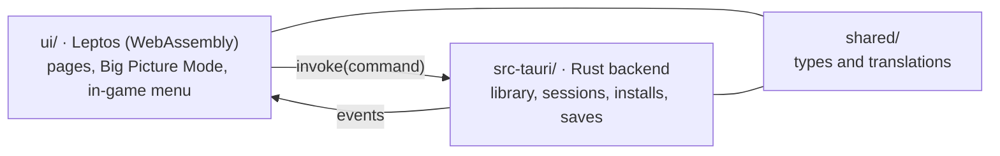

# Architecture

How the code is organized and how the pieces talk to each other.

## Overview

Cerberus is a [Tauri 2](https://tauri.app) app written entirely in Rust:

- **`ui/`**: the interface, written with [Leptos 0.8](https://leptos.dev) in client-side rendering mode, compiled to WebAssembly with [Trunk](https://trunkrs.dev) and shown in WebView2.
- **`src-tauri/`**: the backend. It owns the disk, the network and the games' processes.
- **`shared/`**: types both sides use, such as `Game` and `SettingsView`, and the [translations](translations.md). A field renamed on one side fails to compile on the other, instead of breaking at runtime.
- **`tools/catalog-builder/`**: a command-line tool that keeps the recomp catalog up to date. See [Recomp catalog](catalog.md).

The UI calls the backend with Tauri commands (`ui/src/api.rs` → `#[tauri::command]` functions in `src-tauri/src/main.rs`). The backend pushes changes with events, such as install progress, a game starting or closing, a screenshot taken, or the catalog changing.

## Backend modules (`src-tauri/src/`)

| Module | Responsibility |
|---|---|
| `main.rs` | App setup, the tray, and every Tauri command |
| `library.rs`, `library/recovery.rs` | Games added by hand and recomps (`library.json`); recovering a damaged file |
| `steam.rs`, `epic.rs`, `steam_store.rs` | Finding Steam and Epic games; names and covers from the Steam store |
| `sessions.rs`, `sessions/windows.rs`, `store_time.rs` | Starting games, tracking their processes and play time, backups when they close |
| `recomp/` | The recomp catalog (`catalog.rs`), releases from GitHub/GitLab/Forgejo (`releases.rs`, `forge.rs`), downloads and installs (`install.rs`, `update.rs`, `relocate.rs`), saves and cloud (`saves.rs`, `cloud.rs`), recomps already on disk (`adopt.rs`), custom sources (`sources.rs`) |
| `roms.rs` | Scanning ROM folders, reading N64 headers, grouping multi-disc games |
| `iso9660.rs`, `xdvdfs.rs`, `disc_image.rs` | Reading disc images, including CHD and CSO, for Easy Setup |
| `emulation.rs`, `retroachievements.rs` | RetroArch, cores, BIOS, achievements |
| `achievements/` | The achievements hub: `steam.rs` reads the Steam client's binary stats cache, `steam_api.rs` the optional Steam Web API (with a disk cache), `retro.rs` RetroAchievements, `live.rs` unlock notifications while a Steam game runs |
| `mods.rs`, `gamebanana.rs`, `hedge.rs` | Thunderstore and GameBanana mods; the Hedge Mod Manager format |
| `looks/` | Visual filters through ReShade |
| `game_settings.rs` | The games' own settings files |
| `screenshots.rs`, `overlay.rs` | F12 screenshots and the in-game menu |
| `crash.rs` | Explaining exit codes |
| `dlss.rs` | Finding and swapping DLSS DLLs |
| `shortcut.rs`, `steam_shortcuts.rs` | Desktop shortcuts and non-Steam games in Steam |
| `runtimes.rs` | Visual C++ and DirectX checks and installers |
| `trail.rs` | Each game's history (`trail.jsonl`) |
| `settings.rs`, `collections.rs`, `favorites.rs`, `monitors.rs`, `language.rs` | Settings and the rest of the player's choices |
| `background.rs`, `notify.rs` | Tray behavior and Windows notifications |

## UI modules (`ui/src/`)

| Module | Screen |
|---|---|
| `main.rs` | App shell, routing, the `Library` context, toasts |
| `shell.rs`, `home.rs`, `library_page.rs`, `discover.rs`, `pages.rs`, `news.rs` | Sidebar; Home, Library, Discover, Downloads and Saves, What's new |
| `game.rs` and `backups.rs`, `game_settings.rs`, `looks.rs`, `versions.rs`, `customize.rs`, `game_menu.rs` | The game page and its tabs, the right-click menu |
| `classics.rs` | Classics and their pages |
| `achievements.rs` | The achievements hub, a game's achievement page, and the Achievements tab of a game page |
| `settings_page.rs`, `first_run.rs` | Settings and the setup guide |
| `tv/` | Big Picture Mode: pages, sheets, focus, controller input, sounds |
| `overlay.rs` | The in-game menu, shown in its own transparent window |
| `i18n.rs`, `format.rs` | Language choice; numbers and dates |

## Principles

- **The player's data comes first.** Library writes are published only after they reach the disk. Anything written outside Cerberus's folder is backed up first and can be undone.
- **Downloads require an explicit action.** Recomps come from their developers' releases and use the player's own copy. Direct HTTP(S) files from user-added Hydra sources install only when requested; magnet and torrent links are not downloaded.
- **Downloads are verified** against the host's checksum when one is available, and archives are checked for paths that escape their folder.
- **Updates are recoverable.** A new version is staged next to the old one and swapped in one step. An interrupted update is rolled back on the next start.

## See also

- [Building](building.md)
- [CONTRIBUTING.md](../../CONTRIBUTING.md)
