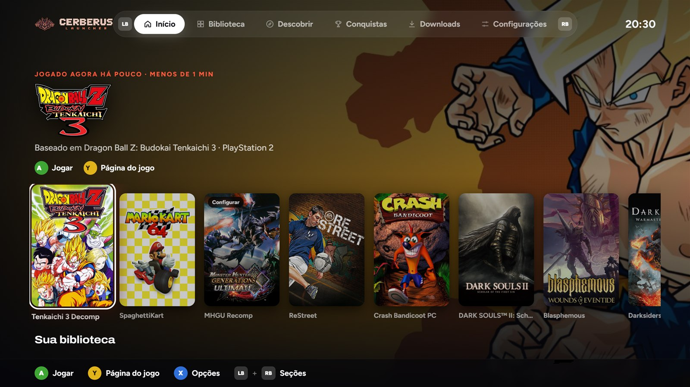

# Big Picture Mode

A full-screen interface made for the couch, with a controller, keyboard or mouse.

## Open and leave

- **Open:** click **Big Picture Mode** in the sidebar, press <kbd>F11</kbd>, or hold **Menu** on a controller for a second.
- **Leave:** hold **Menu** again, press <kbd>F11</kbd>, or choose **Leave Big Picture Mode** in its settings.
- To always start in it, turn on **Settings → Big Picture Mode → Open in Big Picture Mode**, or choose **On a TV** in the setup guide.

It opens on the monitor chosen in **Settings → General → Monitor**. That option shows up only with more than one monitor.

## Sections

**Home**, **Library**, **Discover**, **Downloads** and **Settings**, switched with **LB / RB**.

## Controls

| Action | Controller | Keyboard |
|---|---|---|
| Move | D-pad or left stick | Arrow keys |
| Play / choose | **A** | <kbd>Enter</kbd> |
| Back | **B** | <kbd>Esc</kbd> |
| Game page | **Y** | <kbd>Y</kbd> |
| Options | **X** | <kbd>X</kbd> |
| Switch sections | **LB / RB** | <kbd>Page Up</kbd> / <kbd>Page Down</kbd> |
| Settings | Tap **Menu** | <kbd>F10</kbd> |
| Leave | Hold **Menu** | <kbd>F11</kbd> |

Xbox, PlayStation and Nintendo controllers are told apart by name. On Nintendo controllers, the A and B buttons follow their printed labels.

Search uses an on-screen keyboard. A physical keyboard types straight into it.

**Navigation sounds** can be turned off in **Settings → Big Picture Mode**.

## See also

- [While you play](in-game.md)
- [Settings](settings.md#big-picture-mode)
