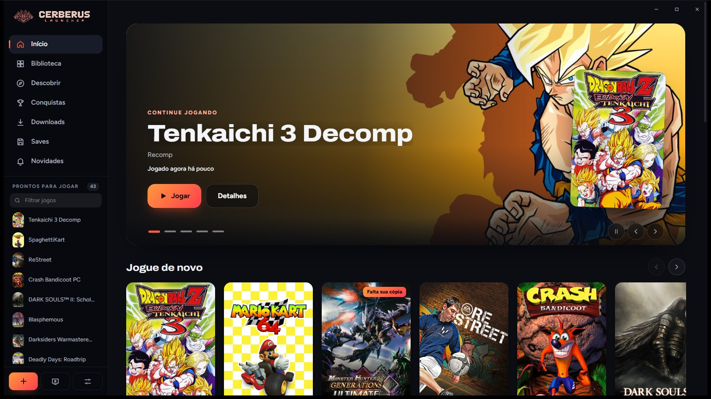
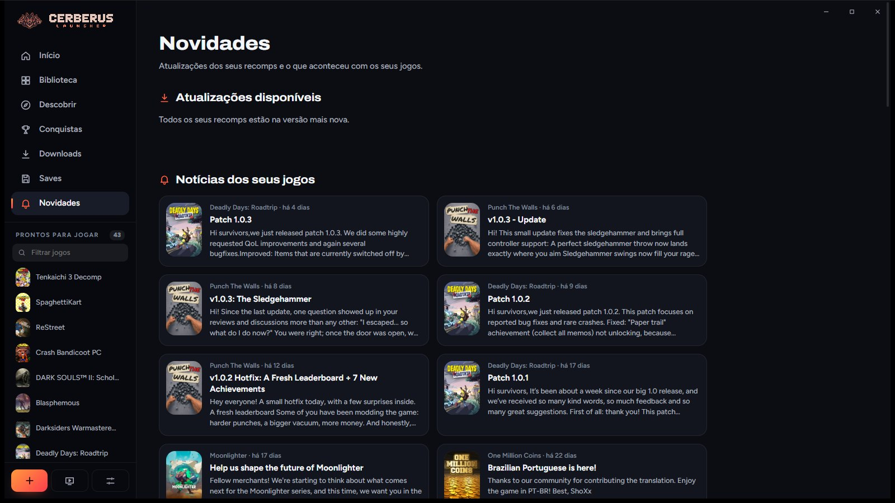

# Home, the side menu and News

## Home

**Home** is where Cerberus opens (you can change that in **Settings → General → Start page**).

- **The banner** at the top shows the game you were playing, then a few recomps worth a look. For your game it shows its logo, when you last played, how long the last session was, your total time and achievement progress, with **Play** and **Details**. It moves on by itself; the arrows and dots move it by hand, and the pause button stops it.
- **Play again:** the games you played most recently.
- **Favorites:** every game you starred.
- **Found in your folders:** recomps for games that are in your ROM folders.
- **Popular now** and **Recently added:** from the recomp catalog.

Hover a cover to get a round **Play** button (or **Install**), so you can start a game without opening its page. A thin bar at the bottom of a cover shows its achievement progress; at 100% it turns gold and says **Platinum**. Each row has arrows at the top right to scroll it.

## The side menu

- **Pages:** Home, Library, Discover, Achievements, Downloads, Saves and News. Downloads and News show a count when something is waiting.
- **Ready to play:** every game you can start right now, favorites first, then the most recently played. A game that is running shows a dot. Hover one for its **Play** button, or click it for its page. With more than 8 games, a filter box appears on top.
- **The tray icon** (next to the clock): right-click it for the 5 games you played most recently, to start one without opening the window, plus **Open Cerberus** and **Quit**.
- **At the bottom:** **+** adds any game (`.exe`), the TV button opens [Big Picture Mode](big-picture.md), and the last one opens [Settings](settings.md).

## News

**News** shows what changed since you last looked:

- **Updates available:** your recomps that have a newer release, with **See what changed** and **Update**.
- **News from your games:** the latest announcements from the developers of your 12 most recently played Steam games: patches, updates and events, with cover, date and the start of the post. Click one to read it on Steam in your browser. It uses Steam's public news, with no key and no account; the answers are kept for 6 hours, so the page opens at once.
- **Recent activity:** installs, play sessions, backups, achievements and problems across all your games. Click a line to open that game's page.
  - A session and the backup made right after it are one line ("3 min played · backup: 8 files copied"), and the same thing happening again for the same game within a day shows once with how many times, like "(2x)".
  - What happened since you last looked has a mark on the left, and the News item in the side menu counts it. **Mark all as read** clears both.
