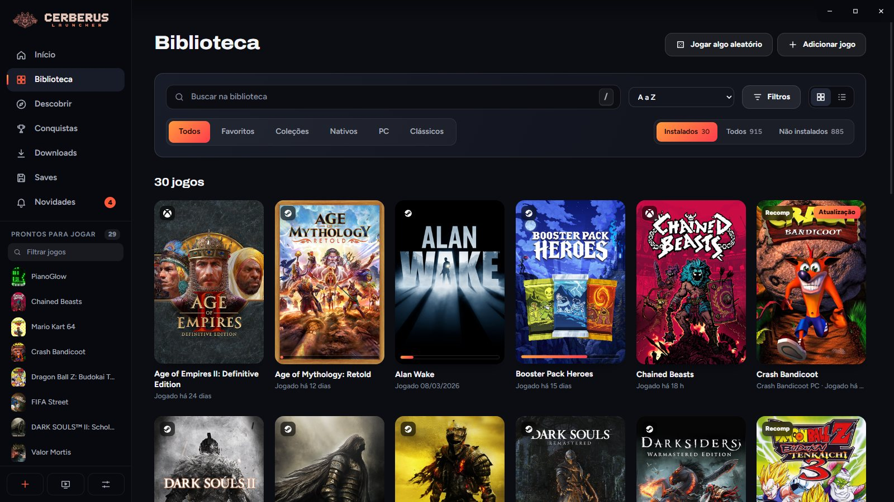

# Library

Every game Cerberus knows about, in one place.

## Where games come from

| Source | How they get in |
|---|---|
| **Steam** | Found on their own in every Steam library folder on the PC. |
| **Epic** | Found on their own from the Epic Games Launcher's install records. |
| **Recomps** | Installed from [Discover](recomps.md), or brought in from a folder you already have. |
| **Added** | Any `.exe` you add with **Add game**. Cerberus looks up the name and cover on Steam. |
| **Classics** | ROMs and disc images found in your ROM folders. See [Classics](classics.md). |

Steam and Epic games still start through their own launchers. Cerberus opens them and counts play time while it's running, even when it's minimized to the tray.

## Tabs and filters

- **All**, **Favorites**, **Collections**, **Recomps**, **PC** and **Classics** split the library by kind.
- **Hidden** shows up only when something is hidden.
- The source chips (**All sources**, **Steam**, **Epic**, **Added**) filter the PC games.
- Search by name, sort by **A to Z**, **Recently played** or **Most played**, and switch between grid and list view.

## Favorites, collections and hidden games

Right-click any cover for a quick menu:

- **Play**, or whatever the next step is (install, update, set up).
- **Game page**.
- **Favorite**, which also pins the game to the sidebar.
- **Collections**: tick the collections this game belongs to, or create a new one on the spot.
- **Hide from library**: the game moves to the Hidden tab and leaves Home, the sidebar and Big Picture Mode. **Show in library** brings it back.

In the **Collections** tab you can create, rename and delete collections. Deleting a collection never deletes its games.

## Art

- Covers, backgrounds and logos come from the stores, the recomp catalog and [libretro-thumbnails](https://github.com/libretro-thumbnails) for classics.
- **Manage → Customize art** picks community art from [SteamGridDB](https://www.steamgriddb.com) or an image of your own, with crop and zoom. SteamGridDB needs a free API key, added in **Settings → Game art**.
- **Manage → Edit name and cover** renames a game you added by hand.

## The game page

Clicking a game opens its page. It has the stats (play time, last session, versions, stars), what the recomp needs, and these tabs:

| Tab | For |
|---|---|
| **Overview** | Stats, description, setup notes and Easy Setup |
| **Saves** | [Save backups](saves.md) |
| **Settings** | The game's own options and [visual filters](in-game.md#visual-filters) |
| **Mods** | [Mods](mods.md) |
| **Screenshots** | Pictures taken with F12 |
| **Manage** | [Shortcuts, Steam, DLSS, moving and more](managing-games.md) |

Which tabs show up depends on the game. For example, Saves and Mods are only for recomps.

## See also

- [Recomps](recomps.md)
- [Managing a game](managing-games.md)
