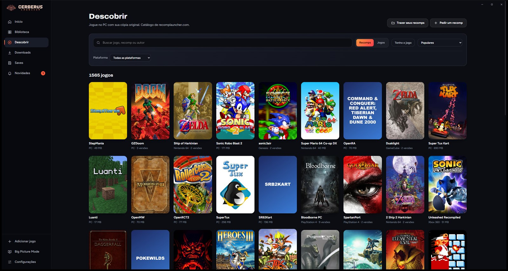

# Recomps

A **recomp** is a native PC version of a console game, rebuilt by the community from the original game's code. Examples are Zelda 64: Recompiled, Ship of Harkinian and Unleashed Recompiled. Recomps don't include the game's data: each one needs **your own copy** of the game.

## Discover

**Discover** lists every recomp and native port Cerberus knows, over 1,500 of them.

- Search by game, recomp or author.
- Show the list **by recomp**, or **by game**, which groups every version of the same game.
- **I own the game** keeps only games found in your ROM folders.
- Sort by **Popular**, **Recently added**, **Recently updated** or **A to Z**, and filter by platform.
- **Genre** chips (Action, Platformers, Racing, RPG...) show how many games each has; click one to keep only that kind, again to clear it.
- **Feature** keeps the recomps that add something: controller support, achievements, local multiplayer, online, higher FPS, widescreen or mods.

The catalog combines Cerberus's own list with the public list from [recomplauncher.com](https://recomplauncher.com). The second one can be turned off in **Settings → Catalog and sources**. See [Recomp catalog](../development/catalog.md).

## A recomp's page

Besides installing and playing, a recomp's page has **About** the original game: release, developer, publisher, series, genres, modes, platforms and critics' score (from IGDB), and the opening of its Wikipedia article in your language, with **Read on Wikipedia**. The article is kept for a month.

## Install

1. Open a recomp's page and click **Install**.
2. Cerberus downloads the release straight from the developers, from GitHub, GitLab or the project's own Forgejo server.
3. The file is checked against the checksum the host publishes. A file that doesn't match is discarded.
4. The archive is unpacked into its own folder. Supported formats are `.zip`, `.7z` and `.tar.gz`, plus releases that ship a single `.exe` or an installer.

While a recomp downloads or installs, the PC doesn't go to sleep (the screen still turns off as usual). You can **pause** a download and **resume** it later from where it stopped. With more than one at a time, **Downloads** has **Pause all** and **Resume all**. **Cancel** deletes the partial file. Progress also shows on the **Downloads** page and in Big Picture Mode.

Some recomps ship a Windows installer. Cerberus runs it the first time you click **Play** and then looks for the installed game. If it can't find the game, it asks you to pick the program.

## Play

The **Play** button always shows the next step:

| Button | Meaning |
|---|---|
| **Install** | Not installed yet |
| **Choose your game copy** | The recomp needs your copy. See [Easy Setup](easy-setup.md) |
| **Open installer** | The release is an installer that hasn't run yet |
| **Locate program** | The game was installed but its program moved or wasn't found |
| **Update to …** | A newer version is out |
| **Play** | Ready |

## Updates

Cerberus checks for new versions on its own. Updates show as a badge on the cover, in **What's new**, and on the **Downloads** page under **Updates ready**, with **Update all** when there are several.

To keep a recomp on the version you have (a new one broke your mods, say), turn on **Manage → Pause updates**. It leaves the update lists until you resume.

The **Downloads** page shows the download in progress with its speed and time left, installs that **didn't finish** with the reason and **Try again**, and your **recent** installs by day. If Windows or an antivirus holds a file while a recomp installs, Cerberus tries again for a few seconds before giving up.

Before updating, Cerberus backs up your saves. It then prepares the new version next to the old one and swaps them only when everything is in place. If an update is interrupted, the previous version is restored the next time Cerberus opens.

## Versions of the same game

Cerberus shows a recomp by **the game it brings**: covers, the side menu, Home, Discover and the game page say "Mario Kart 64", with the recomp ("SpaghettiKart") on the line under it. Searching finds either name, and **A to Z** puts it under the game's letter. Discover can still list by recomp with **Recomps** at the top.

Some games have several recomps or ports, like Majora's Mask with Zelda 64: Recompiled and 2 Ship 2 Harkinian. On the game page, the line under the title says which version you're on ("SpaghettiKart · Nintendo 64 · by HarbourMasters"); with more than one, it opens the others: the one you have first, then the **Recommended** one, then the most downloaded, each with what it adds, its version, size and downloads (two with the same name also show their project). Arrow keys move, Enter picks, Escape closes. Picking one changes only what belongs to the version (buttons, details, what it adds); the game's art stays, and **Install** says which version it installs.

The Overview starts with the game (its Wikipedia and IGDB facts), then **This version** (what it adds, its features, how to start), then what it needs. If the recomp has the original game's copy, **Play ▾** also offers **Play the original** in the emulator.

## Recomps you already have

If you installed recomps without Cerberus:

- **Discover → Bring your recomps** scans a folder and lists the recomps it recognizes.
- On a recomp's page, **I already have it installed** lets you pick its program.

Cerberus brings them in **where they are**. It tracks play time and backs up saves, but never updates or deletes those files.

## Request a recomp

Missing one? Use **Request a recomp** in Discover, which opens a form on GitHub.

## See also

- [Easy Setup](easy-setup.md)
- [Saves](saves.md)
- [Troubleshooting](../help/troubleshooting.md)
