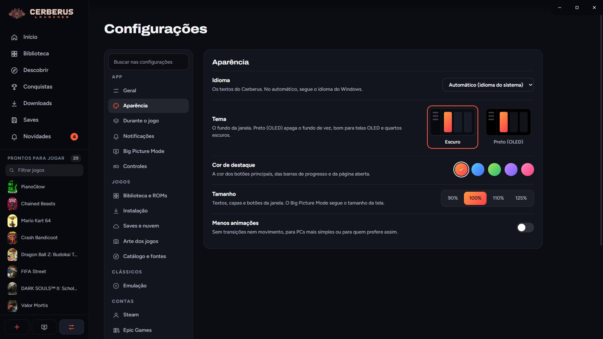

# Settings

Every setting, in the order the **Settings** page shows them.

Looking for one? Type part of its name in the search box above the menu, with or without accents: "tray", "F12" or "cloud". Pick a result (or press Enter for the first) and Settings opens that section with the option marked.

## App

### General

| Setting | What it does |
|---|---|
| **Start page** | Where the window opens: Home, Library or Discover |
| **Monitor** | Where the window and Big Picture Mode open. Shows only with more than one monitor |
| **Initial setup** | **Show again** brings back the first-launch guide |
| **Start with Windows** | Cerberus opens when you sign in to Windows |
| **Start hidden in the tray** | When it starts with Windows, it waits in the tray without showing the window |
| **Keep running in the tray** | Closing the window keeps Cerberus next to the clock. To quit, right-click the tray icon and choose **Quit** |

While a game is running, closing the window always keeps Cerberus in the tray, so it can count play time and back up saves. It quits by itself when the game ends.

### Appearance

| Setting | What it does |
|---|---|
| **Language** | **Automatic** follows Windows: Portuguese for Portuguese speakers, English for everyone else. You can also pick one. The window reloads in the new language |
| **Theme** | **Dark**, or **Black (OLED)** with a fully black background for OLED screens and dark rooms |
| **Accent color** | Orange, blue, green, purple or pink, for main buttons, progress bars and the open page |
| **Size** | 90%, 100%, 110% or 125%: text, covers and buttons in the window. Big Picture Mode follows the screen |
| **Fewer animations** | No transitions or motion |

### While playing

| Setting | What it does |
|---|---|
| **Menu over the game** | <kbd>Ctrl</kbd>+<kbd>F12</kbd>, or View + Menu (or holding View) on a controller, opens the [in-game menu](in-game.md#the-in-game-menu). On by default |
| **Pictures with F12** | <kbd>F12</kbd> saves a [screenshot](in-game.md#screenshots) of the game. On by default |
| **Step aside while playing** | Cerberus minimizes when a game opens and comes back when it closes. Off by default |
| **Achievement notice** | The small notice over the game when an achievement unlocks, the **screen corner** it shows in, and **Test** to see it now |

### Notifications

| Setting | What it does |
|---|---|
| **Game ready to play** | When a recomp finishes installing or updating, or a game's installer finishes |
| **Game closed with an error** | With the reason and a tip, when Cerberus can tell |
| **Picture saved** | Confirms each F12 screenshot |
| **Windows notifications** | With Cerberus not in front, the notice shows in Windows' corner. Off: only inside Cerberus |

Answers to something you just did, like the in-game menu failing to open, always show. The achievement notice has its own settings in **While playing**.

### Big Picture Mode

| Setting | What it does |
|---|---|
| **Open in Big Picture Mode** | Start full screen, for the controller, every time |
| **Navigation sounds** | A short sound when you move, select and go back |

### Controllers

Lists the controllers connected now, with their button layout (Xbox, PlayStation or Nintendo) and the button you're pressing, to check that each one works. Windows only shows a controller after its first button press. Below, what each button does in Big Picture Mode.

## Games

### Library and ROMs

**ROM and game folders**: the folders Cerberus scans for ROMs and disc images. **Scan again** looks for new files.

### Installation

**Recomps folder**: where new recomps are installed, with the free space shown. Games already installed stay where they are.

**Speed limit**: caps recomp downloads (1 to 50 MB/s), or none.

**Slower while you play** (on by default): while a game is open, downloads stay at up to 3 MB/s so the game doesn't lag, and go back to normal when it closes.

### Saves and cloud

**Cloud saves**: the synced folder for save backups, with **Check uploads** and **Turn off**. See [Saves](saves.md).

### Game art

- **SteamGridDB key**: your free API key for community art.
- **Saved images**: covers and backgrounds kept on disk, so pages open fast and work offline. **Clear** deletes them, and they come back as pages need them.

### Catalog and sources

- **recomplauncher.com catalog**: the large public list, turned on by default. When it's off, Discover shows Cerberus's own catalog and your sources.
- **Update now** refreshes the catalog. It also refreshes by itself every 6 hours.
- **Catalog sources**: your own JSON lists. See [Catalog sources](../development/catalog-sources.md).

## Classics

### Emulation

RetroArch (install or use yours), **Cores**, **BIOS** and **Achievements in RetroArch**; then the standalone **Emulators** (DuckStation, PCSX2, RPCS3, PPSSPP, Dolphin, Cemu), **Who opens each console**, and **Use the emulators' folders**. See [Classics](classics.md#standalone-emulators).

## Accounts

### Steam

Optional. Connect your free Steam Web API key so the [Achievements](achievements.md) page shows every game on your account, with achievements earned on any PC. Cerberus finds the Steam account signed in on this PC; **Use another account** takes a profile link or SteamID64. Your profile's **Game details** must be public. **Get my key on Steam** and **Profile privacy** open the right Steam pages.

**Your games in Steam → Add all** puts every installed game that isn't from Steam (recomps, games you added, Epic games) into the Steam library at once, with covers, opening through Cerberus. Games already there are left as they are, and hidden games are skipped. Close Steam first: it rewrites its list of games when it closes.

### Epic Games

Shows whether the Epic Games Launcher is on this PC and how many of its installed games are in the Library. No account or password: Cerberus reads what Epic already keeps on the PC. **Open Epic** opens the launcher. Play time is counted; Epic achievements aren't shown yet.

### RetroAchievements

Connect with your username and Web API key to see your profile, points and recent games.

## System

### Your PC

Checks what games need from Windows, and installs it from Microsoft's website with your permission:

- **Visual C++ 2015-2022 (64-bit)**. Most recomps need it. When it's missing or old, games close right after opening, with error `0xC0000135` or `0xC0000139`.
- **DirectX (legacy components)**: D3DX, XInput 1.3 and XAudio 2.7, for older PC ports.

### Storage

**Cerberus data**: opens the data folder and shows the free space for downloads.

**Copy my data** saves one `.zip` with the library, favorites, collections, notes, play time, the covers you picked and your settings. Keys, tokens and passwords never go into it. Saves aren't in it: they have their own [backups](saves.md).

**Restore from a copy** brings that data back, on this PC or another one. What's here is saved first in a `before-restore-<time>` folder inside the data folder, and this PC's keys, accounts and folders (recomps, ROMs, cloud, RetroArch, monitor) stay as they are. Only the files a copy can have are read from the zip. Cerberus opens again at the end.

### About

The version, the license, and **Request a recomp**.

## See also

- [First launch](../getting-started/first-launch.md)
- [Data and privacy](../help/data-and-privacy.md)
